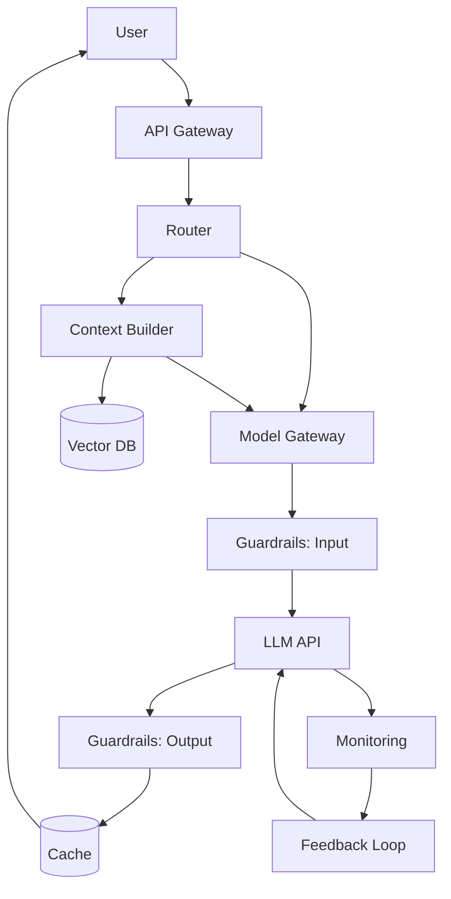

# AI Architecture Blueprint

Эталонная архитектура AI-приложения на основе базовых моделей.

## Слои архитектуры

1. **User Interface** — чат, API, веб-форма.
2. **API Gateway** — единая точка входа, аутентификация, rate limiting.
3. **Router** — классификатор намерений, выбор модели/инструмента.
4. **Context Builder** — RAG, поиск, инструменты для сбора контекста.
5. **Model Gateway** — единый интерфейс к разным LLM.
6. **Guardrails** — фильтрация входа/выхода, PII, токсичность.
7. **Cache** — точное и семантическое кэширование.
8. **Monitoring** — метрики, логи, трассировки.
9. **Feedback Loop** — сбор обратной связи, дообучение.

## Диаграмма
См. `diagram.md` (Mermaid).

## Конфигурации
Примеры конфигов для каждого слоя — в папке `configs/`.

## Принципы
- Модульность: каждый слой можно заменить.
- Наблюдаемость: все слои логируются и метрируются.
- Безопасность: guardrails на входе и выходе.
- Экономика: кэширование и роутинг снижают стоимость.

## Автор
redsea1970

## Оценка

Проект — эталонная архитектура, а не исполняемый код. «Оценка» здесь означает проверку полноты слоёв:
- Слоёв в архитектуре: 9 (UI, Gateway, Router, Context Builder, Model Gateway, Guardrails, Cache, Monitoring, Feedback Loop).
- Покрыто конфигами: 4 (`cache.yaml`, `gateway.yaml`, `guardrails.yaml`, `router.yaml`).
- Покрыто кодом-заготовкой: `prompts.py` (версионирование), `guardrails.py` (PII, токсичность, JSON).
- Схема: `diagram.md` (Mermaid).

## Ограничения
- Это blueprint, а не рабочий сервис: нет запускаемого кода, только конфиги и схема.
- Конфиги — примеры, а не production-готовые (нет секретов, rate limits, retry-политик).
- `guardrails.py` — демо-фильтр PII и токсичности, не замена реальному модератору.
- Для production нужно: реализовать каждый слой (FastAPI/aiogram/Streamlit), добавить мониторинг (Prometheus/Grafana), трассировки (OpenTelemetry).

## Архитектура (слои)

